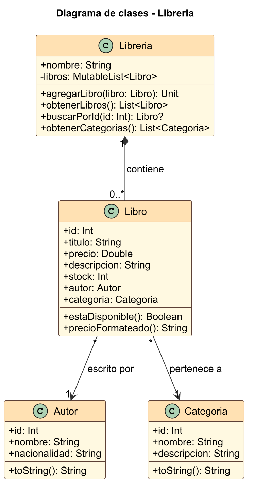
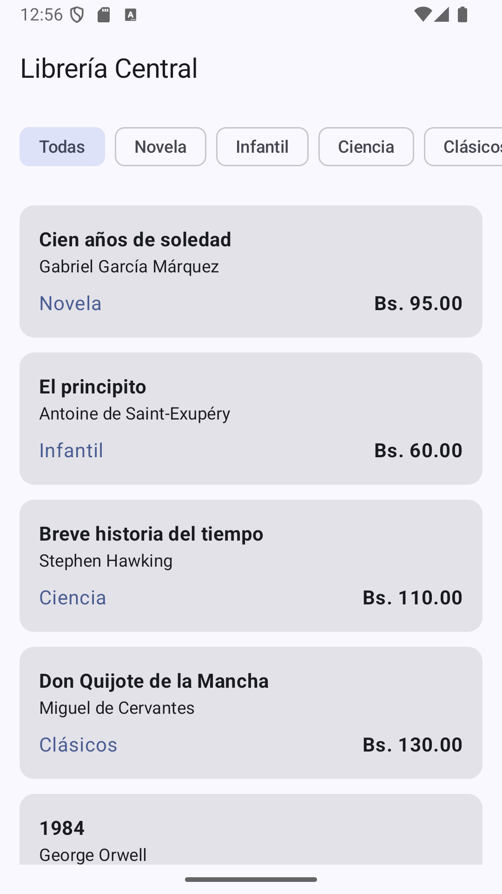
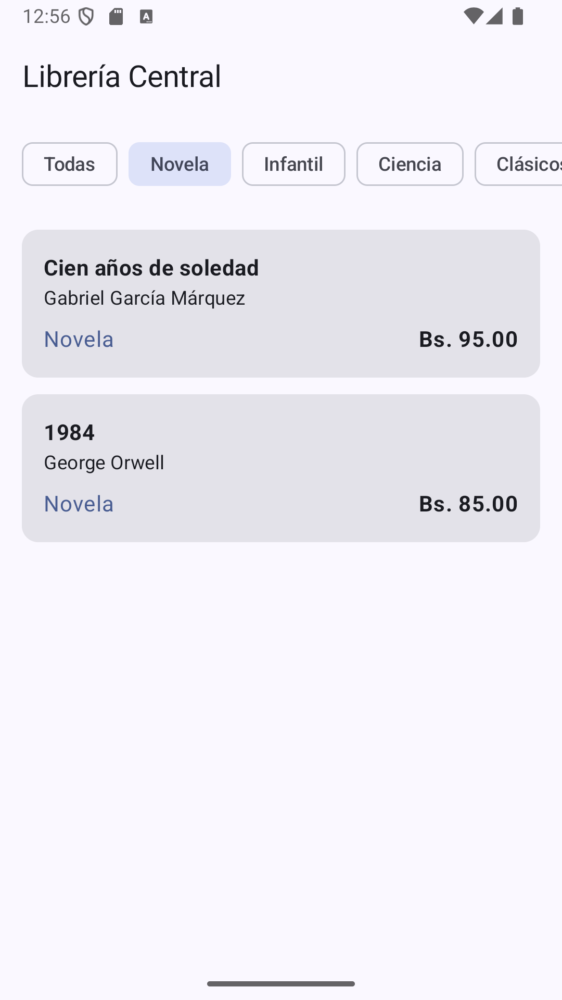
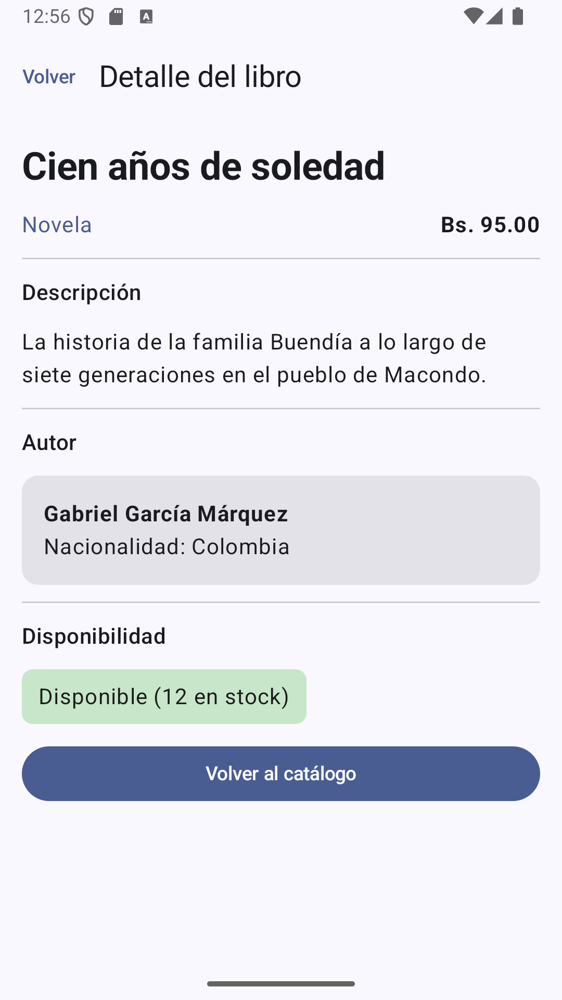
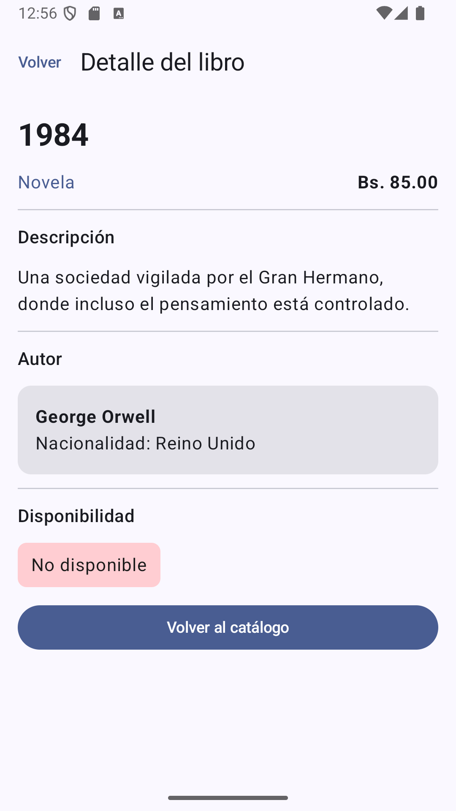

# 📚 Librería – Primer Examen de Programación III

Aplicación Android para consultar el catálogo de una librería, hecha con **Kotlin** y
**Jetpack Compose**.

| | |
|---|---|
| **Universidad** | Universidad Privada Boliviana (UPB) |
| **Materia** | Programación III |
| **Docente** | Johnn Hidalgo |
| **Examen** | Primer examen parcial |
| **Caso de estudio** | Librería |
| **Repositorio** | https://github.com/leynarue/PrimerExamenProgra3 |

---

## 1. Descripción

La aplicación muestra un catálogo de libros y permite consultar el detalle de cada uno: autor,
categoría, precio, descripción y disponibilidad. Los datos salen de objetos reales de las clases
del modelo (`Libro`, `Autor`, `Categoria` y `Libreria`), no de textos escritos en las pantallas.

## 2. Objetivo

Aplicar los conceptos de Programación Orientada a Objetos en Kotlin y construir una interfaz con
Jetpack Compose que liste al menos dos de los objetos implementados, subiendo todo el trabajo de
forma progresiva a GitHub.

## 3. Caso de estudio: Librería

Una librería vende libros. Cada libro tiene un autor y pertenece a una categoría. La aplicación
permite ver el catálogo, filtrarlo por categoría y abrir el detalle de un libro.

## 4. Tecnologías utilizadas

| Tecnología | Versión (del proyecto) |
|---|---|
| Kotlin | 2.2.10 |
| Android Gradle Plugin | 9.5.1 |
| Gradle | 9.6.0 |
| Jetpack Compose (BOM) | 2026.02.01, con Material 3 |
| Android | minSdk 24, compileSdk y targetSdk 37 |
| Control de versiones | Git y GitHub |
| Diagramas | PlantUML |

No se agregaron dependencias nuevas a las que trae el proyecto de Android Studio.

---

## 5. Modelo de clases

Diagrama de clases UML hecho con PlantUML:



- 👁️ [Ver el diagrama en GitHub](https://github.com/leynarue/PrimerExamenProgra3/blob/main/docs/diseno/diagrama_clases.png)
- ⬇️ [Descargar la imagen PNG](https://github.com/leynarue/PrimerExamenProgra3/raw/main/docs/diseno/diagrama_clases.png)
- 📄 [Código fuente PlantUML](docs/diseno/diagrama_clases.puml)
- 📝 [Documento de diseño](docs/diseno/DISENO_CLASES.md)

### Relaciones

| Relación | Tipo | Multiplicidad |
|---|---|---|
| `Libreria` → `Libro` | Composición | 1 a 0..* |
| `Libro` → `Autor` | Asociación | * a 1 |
| `Libro` → `Categoria` | Asociación | * a 1 |

No se usa herencia ni interfaces: ninguna clase las necesita.

## 6. Descripción de las clases

Todas están en [`modelo/`](app/src/main/java/com/example/primerexamenprogra3/modelo).

| Clase | Atributos | Métodos | Función |
|---|---|---|---|
| [`Autor`](app/src/main/java/com/example/primerexamenprogra3/modelo/Autor.kt) | `id`, `nombre`, `nacionalidad` | `toString()` | Quien escribió el libro. |
| [`Categoria`](app/src/main/java/com/example/primerexamenprogra3/modelo/Categoria.kt) | `id`, `nombre`, `descripcion` | `toString()` | Tipo de libro (Novela, Ciencia...). |
| [`Libro`](app/src/main/java/com/example/primerexamenprogra3/modelo/Libro.kt) | `id`, `titulo`, `precio`, `descripcion`, `stock`, `autor`, `categoria` | `estaDisponible()`, `precioFormateado()` | Objeto central del catálogo. |
| [`Libreria`](app/src/main/java/com/example/primerexamenprogra3/modelo/Libreria.kt) | `nombre`, `libros` (privado) | `agregarLibro()`, `obtenerLibros()`, `buscarPorId()`, `obtenerCategorias()` | Guarda la colección de libros. |

Además, [`DatosEjemplo.kt`](app/src/main/java/com/example/primerexamenprogra3/modelo/DatosEjemplo.kt)
tiene la función `crearLibreriaDeEjemplo()`, que crea 4 categorías, 5 autores y 5 libros de prueba.
Es una función, no una clase, por eso no aparece en el diagrama.

**Conceptos de POO aplicados:** clases y objetos, constructores, atributos de solo lectura (`val`),
encapsulamiento (la lista `libros` es privada y se devuelve una copia), relaciones entre clases y
listas de objetos.

---

## 7. Las dos pantallas

Diseño previo: [DISENO_INTERFAZ.md](docs/diseno/DISENO_INTERFAZ.md).

### Pantalla 1 – Catálogo de libros
[`PantallaCatalogo.kt`](app/src/main/java/com/example/primerexamenprogra3/ui/PantallaCatalogo.kt)

Muestra una fila de categorías (para filtrar) y la lista de libros con título, autor, categoría y
precio. Al tocar un libro se abre su detalle.

Componentes: `Scaffold`, `TopAppBar`, `Column`, `LazyRow`, `FilterChip`, `LazyColumn`, `Card`,
`Row`, `Text`.

### Pantalla 2 – Detalle del libro
[`PantallaDetalle.kt`](app/src/main/java/com/example/primerexamenprogra3/ui/PantallaDetalle.kt)

Muestra título, categoría, precio, descripción, datos del autor y la disponibilidad (verde si hay
stock, rojo si no). Tiene botones para volver al catálogo.

Componentes: `Scaffold`, `TopAppBar`, `Column` con `verticalScroll`, `Card`, `Surface`,
`HorizontalDivider`, `Button`, `TextButton`, `Text`.

### Navegación
[`MainActivity.kt`](app/src/main/java/com/example/primerexamenprogra3/MainActivity.kt) guarda el
id del libro elegido. Si es `null` muestra el catálogo; si no, muestra el detalle. El botón "atrás"
del teléfono también regresa al catálogo (`BackHandler`). No se usó una librería de navegación.

## 8. Capturas de la aplicación funcionando

Capturas reales tomadas en el emulador Android (Pixel, Android 16, API 36).

| Catálogo | Filtro "Novela" |
|:---:|:---:|
|  |  |

| Detalle (disponible) | Detalle (no disponible) |
|:---:|:---:|
|  |  |

---

## 9. Estructura del proyecto

```
PrimerExamenProgra3/
├── app/src/main/java/com/example/primerexamenprogra3/
│   ├── MainActivity.kt          # Navegación entre pantallas
│   ├── modelo/                  # Clases del dominio
│   │   ├── Autor.kt
│   │   ├── Categoria.kt
│   │   ├── Libro.kt
│   │   ├── Libreria.kt
│   │   └── DatosEjemplo.kt      # Libros de prueba
│   └── ui/
│       ├── PantallaCatalogo.kt  # Pantalla 1
│       ├── PantallaDetalle.kt   # Pantalla 2
│       └── theme/               # Tema de Compose (plantilla)
├── docs/
│   ├── diseno/                  # Diagrama UML y diseño de interfaz
│   ├── capturas/                # Capturas de la app
│   └── evidencias/              # Evidencia de compilación y ejecución
├── scripts/                     # Scripts usados en el examen
├── BITACORA_IA.md               # Registro del uso de Claude
├── CONVERSACION_CLAUDE.md       # Conversación con Claude
└── README.md
```

## 10. Instrucciones de instalación y ejecución

**Requisitos:** Android Studio reciente y un emulador o dispositivo Android (API 24 o superior).

1. Clonar el repositorio:
   ```powershell
   git clone https://github.com/leynarue/PrimerExamenProgra3.git
   ```
2. Abrir la carpeta en Android Studio y esperar a que termine la sincronización de Gradle.
3. Elegir un emulador o conectar un dispositivo.
4. Presionar **Run ▶** (o `Shift + F10`).

Para compilar desde la terminal:

```powershell
.\scripts\compilar.ps1
```

El APK queda en `app/build/outputs/apk/debug/app-debug.apk`.

---

## 11. Los seis checkpoints

| # | Checkpoint | Puntos | Qué se entregó |
|---|---|:---:|---|
| 1 | Diseño de clases | 15 | [Diagrama UML](docs/diseno/diagrama_clases.png), [fuente PlantUML](docs/diseno/diagrama_clases.puml) y [documento de diseño](docs/diseno/DISENO_CLASES.md). |
| 2 | Implementación | 10 | Clases Kotlin en [`modelo/`](app/src/main/java/com/example/primerexamenprogra3/modelo). |
| 3 | Scripts | 10 | [`scripts/`](scripts) con el generador del diagrama y el de compilación. **Tercer commit.** |
| 4 | Diseño de interfaz | 25 | [Bocetos y componentes de Compose](docs/diseno/DISENO_INTERFAZ.md). |
| 5 | Interfaz | 20 | Dos pantallas en [`ui/`](app/src/main/java/com/example/primerexamenprogra3/ui) y navegación. |
| 6 | Compilación y ejecución | 20 | [Evidencia de compilación](docs/evidencias/compilacion.txt) y [capturas](docs/capturas). |

## 12. Registro de avances (commits)

| # | Commit | Mensaje |
|---|---|---|
| 1 | [`ae549ea`](https://github.com/leynarue/PrimerExamenProgra3/commit/ae549ea) | Checkpoint 1: diseño de clases de la Librería |
| 2 | [`47b5e7a`](https://github.com/leynarue/PrimerExamenProgra3/commit/47b5e7a) | Checkpoint 2: implementación de las clases en Kotlin |
| 3 | [`7157efc`](https://github.com/leynarue/PrimerExamenProgra3/commit/7157efc) | Checkpoint 3: scripts utilizados en el examen |
| 4 | [`ff64e38`](https://github.com/leynarue/PrimerExamenProgra3/commit/ff64e38) | Checkpoint 4: diseño de las interfaces |
| 5 | [`84a7579`](https://github.com/leynarue/PrimerExamenProgra3/commit/84a7579) | Checkpoint 5: implementación de las pantallas con Jetpack Compose |
| 6 | Último commit del historial (`git log`) | Checkpoint 6: pruebas y documentación final |

Ver el historial completo: `git log --oneline` o la
[página de commits](https://github.com/leynarue/PrimerExamenProgra3/commits/main).

## 13. Uso de inteligencia artificial

El proyecto se desarrolló con la ayuda de Claude. El registro está en:

- [BITACORA_IA.md](BITACORA_IA.md): etapas, prompts, decisiones, errores y soluciones.
- [CONVERSACION_CLAUDE.md](CONVERSACION_CLAUDE.md): conversación con Claude.

## 14. Verificación

- **Compilación:** `gradlew clean assembleDebug testDebugUnitTest` terminó con BUILD SUCCESSFUL.
  Salida completa en [docs/evidencias/compilacion.txt](docs/evidencias/compilacion.txt).
- **Ejecución:** la app se instaló y se abrió en un emulador Pixel (Android 16). Se probaron el
  catálogo, el filtro por categoría, el detalle de un libro disponible y de uno sin stock, y los
  botones de volver.
