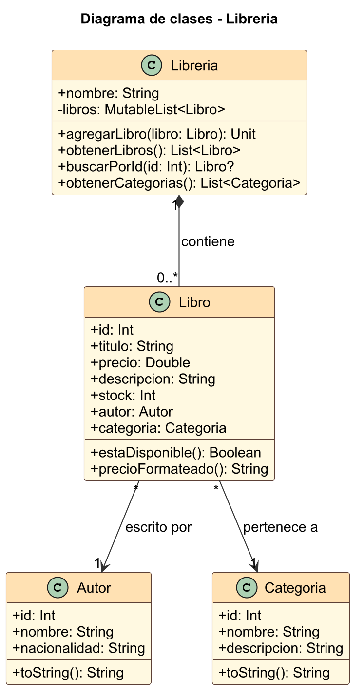

# Checkpoint 1 – Diseño de clases (Librería)

Caso de estudio: **Librería**. Materia: Programación III – UPB. Docente: Johnn Hidalgo.

## Análisis del problema

La aplicación muestra un catálogo de libros y el detalle de cada uno. De ese enunciado salen
cuatro conceptos: el **libro**, quien lo **escribió**, el **tipo** de libro y la **librería**
que los reúne.

## Diagrama de clases



- Código fuente PlantUML: [diagrama_clases.puml](diagrama_clases.puml)
- Imagen PNG: [diagrama_clases.png](diagrama_clases.png)

## Clases

| Clase | Atributos | Métodos | Para qué sirve |
|---|---|---|---|
| `Autor` | `id: Int`, `nombre: String`, `nacionalidad: String` | `toString()` | Representa a quien escribió el libro. |
| `Categoria` | `id: Int`, `nombre: String`, `descripcion: String` | `toString()` | Agrupa libros por tipo (novela, ciencia, etc.). |
| `Libro` | `id: Int`, `titulo: String`, `precio: Double`, `descripcion: String`, `stock: Int`, `autor: Autor`, `categoria: Categoria` | `estaDisponible()`, `precioFormateado()` | Objeto central del catálogo. |
| `Libreria` | `nombre: String`, `libros: MutableList<Libro>` (privado) | `agregarLibro()`, `obtenerLibros()`, `buscarPorId()`, `obtenerCategorias()` | Guarda la colección de libros y la entrega a las pantallas. |

## Relaciones

| Relación | Tipo | Multiplicidad | Explicación |
|---|---|---|---|
| `Libreria` → `Libro` | Composición | 1 a 0..* | La librería contiene sus libros; sin librería no hay catálogo. |
| `Libro` → `Autor` | Asociación | * a 1 | Cada libro tiene un autor; un autor puede tener varios libros. |
| `Libro` → `Categoria` | Asociación | * a 1 | Cada libro tiene una categoría; una categoría agrupa varios libros. |

## Decisiones de diseño

- **Sin herencia ni interfaces.** Ninguna clase necesita un "padre" común, así que no se agregan.
- **Atributos de solo lectura (`val`).** Los datos de un libro no cambian durante la app.
- **Encapsulamiento.** Solo la lista `libros` es privada; se usa mediante métodos de `Libreria`.
- **Dos tipos de objeto en pantalla.** El catálogo lista `Libro` y `Categoria`; el detalle muestra
  `Libro` junto con su `Autor`, como pide el examen.

## Regenerar el diagrama

```powershell
java -jar plantuml.jar -tpng -charset UTF-8 docs/diseno/diagrama_clases.puml
```

> Si se modifica una clase Kotlin, hay que actualizar el `.puml` y volver a generar el PNG.
