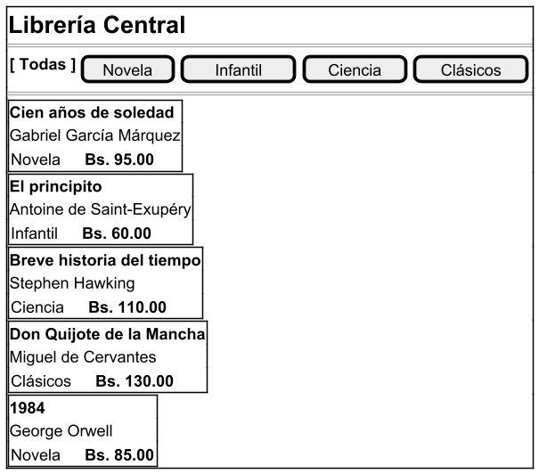
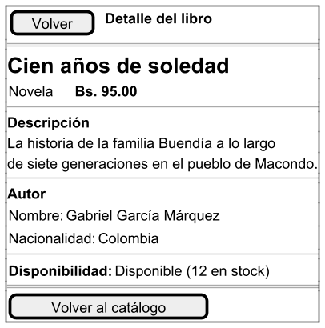

# Checkpoint 4 – Diseño de interfaz (Librería)

Dos pantallas hechas con Jetpack Compose. Los bocetos usan los mismos datos que
`crearLibreriaDeEjemplo()`, es decir, objetos reales de las clases del modelo.

## Objetos del modelo que se muestran

| Objeto | Dónde aparece |
|---|---|
| `Libro` | Pantalla 1 (lista) y Pantalla 2 (detalle) |
| `Categoria` | Pantalla 1 (fila de filtros y etiqueta de cada libro) |
| `Autor` | Pantalla 1 (nombre en cada tarjeta) y Pantalla 2 (nombre y nacionalidad) |

Así se cumple lo que pide el examen: las pantallas listan al menos dos de los objetos implementados.

## Pantalla 1 – Catálogo de libros



**Qué muestra:** el nombre de la librería, una fila de categorías para filtrar y la lista de libros
con título, autor, categoría y precio.

**Cómo se usa:**
- Al tocar una categoría (por ejemplo "Novela") la lista muestra solo los libros de esa categoría.
  "Todas" quita el filtro.
- Al tocar una tarjeta de libro se abre la Pantalla 2.

**Componentes de Jetpack Compose:**

| Componente | Para qué se usa |
|---|---|
| `Scaffold` | Estructura base de la pantalla: barra superior y contenido. |
| `TopAppBar` | Barra superior con el nombre de la librería. |
| `Column` | Apila verticalmente la fila de filtros y la lista. |
| `LazyRow` | Fila horizontal de categorías que se puede deslizar. |
| `FilterChip` | Cada botón de categoría, con estado seleccionado / no seleccionado. |
| `LazyColumn` | Lista de libros; solo dibuja los elementos visibles. |
| `Card` | Tarjeta de cada libro, tocable. |
| `Row` | Alinea la categoría a la izquierda y el precio a la derecha. |
| `Text` | Título, autor, categoría y precio. |

## Pantalla 2 – Detalle del libro



**Qué muestra:** título, categoría, precio, descripción completa, datos del autor (nombre y
nacionalidad) y la disponibilidad (disponible con su stock, o "No disponible").

**Cómo se usa:** el botón "Volver" (arriba y abajo) regresa al catálogo. El botón "atrás" del
teléfono hace lo mismo.

**Componentes de Jetpack Compose:**

| Componente | Para qué se usa |
|---|---|
| `Scaffold` y `TopAppBar` | Estructura y barra superior con el botón de volver. |
| `Column` con `verticalScroll` | Apila las secciones y permite desplazar si el texto es largo. |
| `Text` | Título, descripción y datos del autor. |
| `Card` | Agrupa la información del autor. |
| `Surface` | Etiqueta de color para la disponibilidad (verde disponible, rojo no disponible). |
| `HorizontalDivider` | Separa las secciones. |
| `Button` y `TextButton` | Volver al catálogo. |

## Navegación y datos

- **Navegación:** sin librería extra. Una variable de estado (`libroSeleccionado: Libro?`) decide
  qué pantalla se muestra: si es `null`, el catálogo; si tiene un libro, el detalle. Un
  `BackHandler` hace que el botón "atrás" del teléfono vuelva al catálogo.
- **Datos:** la librería se crea una vez con `crearLibreriaDeEjemplo()` y las pantallas leen
  `libreria.obtenerLibros()` y `libreria.obtenerCategorias()`. No hay textos escritos a mano en
  las pantallas.
- **Filtro por categoría:** es una mejora pequeña; usa una variable de estado
  (`categoriaSeleccionada`) y filtra la lista de libros.

## Archivos previstos para el Checkpoint 5

| Archivo | Contenido |
|---|---|
| `ui/PantallaCatalogo.kt` | Composable del catálogo. |
| `ui/PantallaDetalle.kt` | Composable del detalle. |
| `MainActivity.kt` | Crea la librería y decide qué pantalla mostrar. |

## Regenerar los bocetos

```powershell
java -jar plantuml.jar -tpng -charset UTF-8 docs/diseno/interfaz/pantalla_catalogo.puml
java -jar plantuml.jar -tpng -charset UTF-8 docs/diseno/interfaz/pantalla_detalle.puml
```
